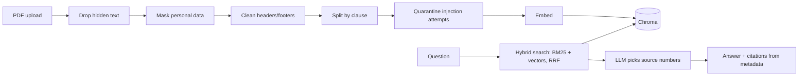

# LoanLens

[](https://github.com/tarunshhharma/LoanLens/actions/workflows/ci.yml)

**Ask questions about a loan agreement and get answers that cite the exact clause and page.** LoanLens also pulls out ten key terms (rate, EMI, prepayment charges, ...) and flags risky ones, such as a "fixed" rate the bank is allowed to change.

**Live demo:** https://loanlens-w4kp.onrender.com (access code on request; it is the free tier, so the first visit may take a minute to wake up)

Built with FastAPI, Chroma, OpenAI and Streamlit. Tested on three real home and personal loan agreements from Indian banks, up to 75 pages long.

---

## What it does

| | |
|---|---|
| **Cited Q&A** | "What happens if I miss an EMI?" returns an answer plus labels for the clauses it came from, e.g. `Clause 9.2, page 14`. If the agreement doesn't say, it answers "not found" instead of guessing. |
| **Key terms** | Ten typed fields (loan amount, interest rate, rate type, tenure, EMI, processing fee, prepayment charges, penal charges, ...), each with its source clause. |
| **Risk flags** | Five plain-Python rules over the extracted terms, e.g. a floating rate with a prepayment charge, or a stated EMI that doesn't match the reducing-balance formula. |
| **Safe uploads** | Hidden text is dropped, personal data (PAN, Aadhaar, account numbers, phone, email) is masked before storage, and prompt-injection attempts are quarantined. |

## How it works



- **Clause-aware splitting.** A hand-written splitter detects the agreement's numbering style (`2. LOAN AMOUNT` / `3.1.`, `5.1 Interest`, `ARTICLE 2` / `2.1`) and makes one chunk per clause, plus one per defined term. Unknown formats fall back to one chunk per page.
- **Hybrid retrieval.** BM25 finds exact terms ("foreclosure", "Schedule 2"); embeddings find paraphrases ("pay off early"). Results are merged with Reciprocal Rank Fusion (k = 60), written by hand.
- **Citations the model can't invent.** The model only returns source numbers (`[1, 3]`). Clause labels and page numbers are built from stored metadata, and a reply citing a source that wasn't given is rejected.
- **Validated extraction.** Terms are parsed into a strict Pydantic schema (`Term[Percent]`, `Term[Rupees]`, ...); anything that fails validation is dropped with a warning, not shown.
- **Rules, not the LLM, raise risk flags**, so every flag is explainable and unit-tested.

The reasoning behind every choice (52 decisions) and the known limitations are in [DECISIONS.md](DECISIONS.md).

## Results

**Golden set:** 40 hand-labelled questions over three real agreements, each checked against the source text ([`evals/golden.jsonl`](evals/golden.jsonl)).

| Metric | Score |
|---|---|
| Retrieval hit rate | 94% |
| Citation accuracy | 91% |
| Answer accuracy | 88% |
| "Not found" accuracy | 83% |
| **Overall** | **88%** |

Retrieval and answering are scored separately, so a failure points at its cause. The main remaining miss is charges tables: questions retrieve the clause that *refers* to the schedule instead of the table with the number.

**Attack suite:** 15 prompt-injection and hidden-text attacks run through the real pipeline ([`evals/attacks.json`](evals/attacks.json)). All 15 are stopped. The first run stopped 14: leetspeak in white text slipped past the scanner, which led to the hidden-text filter.

**Tests:** 375 pytest tests, run in CI on every push with no API key (the model, embedder and database are injected fakes).

## Run it

You need Python 3.13 and an OpenAI API key.

```bash
git clone https://github.com/tarunshhharma/LoanLens.git
cd LoanLens
echo "OPENAI_API_KEY=sk-..." > .env
```

**With Docker** (API on :8000, UI on :8501, uploads kept in a volume):

```bash
docker compose up --build
```

**Without Docker:**

```bash
python -m venv venv
source venv/bin/activate        # Windows: venv\Scripts\activate
pip install -r requirements.txt
uvicorn app.main:app            # terminal 1
python -m streamlit run ui/app.py   # terminal 2
```

Open http://localhost:8501. API docs are at http://localhost:8000/docs.

### API

| Endpoint | Body | Returns |
|---|---|---|
| `POST /upload` | PDF file (multipart, max 20 MB) | `doc_id`, chunks, warnings, redaction counts |
| `POST /ask` | `{"doc_id", "question"}` | answer, `found`, citations |
| `POST /extract` | `{"doc_id"}` | ten terms with citations, risk flags |
| `GET /health` | | `{"status": "ok"}` |

## Tests and evaluations

```bash
pytest                                       # 375 tests, no API key needed
ruff check .
python -m scripts.run_attacks --offline      # upload attacks, no API key
python -m scripts.run_attacks                # all 15 attacks, uses the model
python -m scripts.run_evals                  # golden set (needs the sample PDFs)
```

The sample agreements are not committed. Put PDFs in `samples/` with the names listed in `scripts/run_evals.py`.

## Project layout

```
app/        FastAPI app: parsing, cleaning, splitting, storage, retrieval, answering, extraction, risk, security
ui/         Streamlit client (talks to the API over HTTP)
tests/      pytest suite and fixture PDFs
evals/      golden questions, attack cases, saved eval runs
scripts/    eval and attack runners, fixture generator
deploy/     start script for the single-container Render deploy
```

## Deployment

CI (GitHub Actions) runs lint, tests, the offline attack suite and a Docker build on every push. Render redeploys only after CI passes (`render.yaml`). The demo runs as one container: Streamlit is public, the API listens on `127.0.0.1` inside it, and an access code keeps strangers from spending the OpenAI credit.

## Limitations

- Scanned (image-only) PDFs are rejected; there is no OCR.
- Agreement text is sent to OpenAI, after personal data is masked. Banks needing on-premise processing would need local models.
- Charges tables are the weakest retrieval case (see Results).
- Demo uploads are temporary: the free tier has no persistent disk.

LoanLens explains what an agreement says. It is not legal or financial advice.
